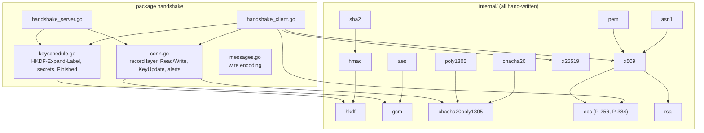
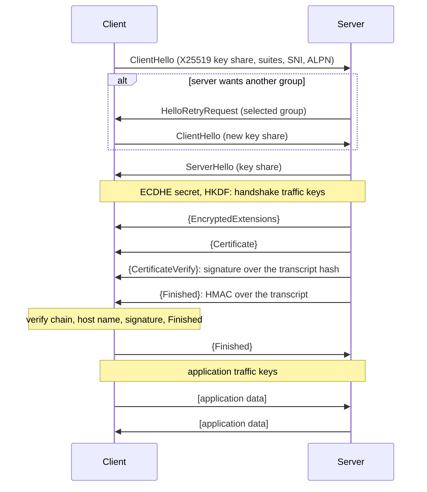

# handshake

[](https://github.com/pMag11-alt/handshake/actions/workflows/ci.yml)


**TLS 1.3 from scratch in Go: the protocol and every cryptographic primitive
under it.** handshake is a client and a server for RFC 8446. Its record
layer, handshake state machines and key schedule sit on code written for this
repository, not on `crypto/*`:

- SHA-256/384/512, HMAC and HKDF
- AES-GCM and ChaCha20-Poly1305
- X25519, plus P-256 and P-384 ECDH/ECDSA
- RSA-PSS and PKCS #1 v1.5
- ASN.1 DER and X.509 path validation

From the standard library it takes only `crypto/rand` (for entropy) and
`math/big`. It talks to real servers on the internet, to OpenSSL, to curl and
to Go's own `crypto/tls`.

```console
$ tlsget -v https://example.com/
   45.75ms  TCP connected to [2606:4700:90d5:72db:f2c5:56e:ef6b:ff98]:443
   46.30ms  -> ClientHello: SNI="example.com" suites=[TLS_AES_128_GCM_SHA256 TLS_CHACHA20_POLY1305_SHA256 TLS_AES_256_GCM_SHA384] groups=[X25519 P-256 P-384] key share=X25519
   69.19ms  <- ServerHello: TLS_AES_128_GCM_SHA256, X25519
   69.46ms  <- EncryptedExtensions (ALPN "http/1.1")
   94.28ms  <- Certificate: chain verified: example.com <- Cloudflare TLS Issuing ECC CA 3 <- SSL.com TLS Transit ECC CA R2 <- SSL.com TLS ECC Root CA 2022 <- AAA Certificate Services
   97.58ms  <- CertificateVerify: ecdsa_secp256r1_sha256 signature over the transcript is valid
   97.59ms  <- Finished: server's transcript MAC matches
   97.74ms  -> Finished
   97.75ms  handshake complete in 51.915ms

protocol      TLS 1.3
cipher suite  TLS_AES_128_GCM_SHA256
key exchange  X25519
signature     ecdsa_secp256r1_sha256
...
< HTTP/1.1 200 OK
<!doctype html><html lang=en><head><title>Example Domain</title>...
```

## How correctness is established

Cryptographic code is only as good as its tests. Each layer is checked
against an independent source of truth:

| Layer | Evidence |
|---|---|
| SHA-2, HMAC, HKDF | FIPS 180 vectors, RFC 4231 and RFC 5869, plus every message length up to 300 bytes against the standard library |
| AES, AES-GCM | FIPS 197 appendix C and the GCM spec's vectors. 600 random AES-128/192/256 keys against `crypto/aes`, and 600 random GCM keys, nonces and lengths against `crypto/cipher`, with tampered ciphertexts rejected |
| ChaCha20, Poly1305 | RFC 8439 vectors, its accumulator wrap-around cases, and 3,000 random messages checked against a `math/big` reference |
| X25519 | RFC 7748: the vectors, 1,000 iterations, the Diffie-Hellman example and low-order points; 200 random keys against `crypto/ecdh` |
| P-256, P-384 | RFC 6979 deterministic signatures; signatures cross-verified with `crypto/ecdsa` in both directions; ECDH against `crypto/ecdh` |
| RSA | PKCS #1 v1.5 and PSS signatures cross-verified with `crypto/rsa` in both directions; generated keys pass `crypto/rsa`'s `Validate` |
| X.509 | Every root in the system trust store (127 on macOS) parses and matches `crypto/x509` field by field, and their self-signatures verify. Real chains for github.com, letsencrypt.org, google.com and cloudflare.com verify through their cross-signed roots. Expired, mis-named, unanchored and tampered chains are rejected |
| Key schedule and record layer | The RFC 8448 trace. Every secret in the 1-RTT example matches, and the server's encrypted flight decrypts. Its RSA-PSS CertificateVerify and Finished verify, and our encrypted client records come out **byte-identical** to the RFC's |
| Handshake | 27 client/server combinations (3 suites × 3 groups × 3 key types), HelloRetryRequest, KeyUpdate, ALPN, close_notify and 640 KB transfers. Verification and negotiation failures map to the right alerts |
| Interop: Go | `crypto/tls` as a server (including forced HelloRetryRequests and KeyUpdate) and as a client verifying our ECDSA and RSA-PSS signatures, across every suite and group |
| Interop: OpenSSL, curl | [`scripts/interop-openssl.sh`](scripts/interop-openssl.sh) runs 48 cases. tlsget connects to `openssl s_server` for 2 certificate types × 3 suites × 3 groups. `openssl s_client` and curl connect to tlsserve for 3 key types × 3 suites × 3 groups |
| The internet | 20 popular sites, including Google, GitHub, Wikipedia, Amazon, Microsoft, Apple, BBC and Netflix. That covers ECDSA and RSA-PSS servers, all three suites, P-256 key exchange and HelloRetryRequest |
| Robustness | Go fuzz targets for every parser, plus one that feeds a client arbitrary "server" bytes. The fuzzer found a real bug: a typed-nil key inside an `any` that panicked during signature checks. The crashing input is kept as a regression test |

## Architecture



A full handshake, as `handshake_client.go` and `handshake_server.go` run it:



Some details worth reading in the code:

- **The transcript.** Every handshake message is hashed in order. After a
  HelloRetryRequest, the first ClientHello is replaced by a synthetic
  `message_hash` message (RFC 8446 section 4.4.1).
- **Record protection.** Each record's nonce is the static IV XOR the 64-bit
  sequence number. The record header is the AEAD's associated data, and the
  real content type hides inside the encrypted payload.
- **Middlebox compatibility.** The client always sends a session ID and
  dummy `change_cipher_spec` records. Both sides ignore those records only in
  the window where they are legal.
- **Constant-time where it is cheap.** X25519 uses a branch-free ladder and
  conditional swap, and MACs are compared without early exit. RSA
  verification compares the whole PKCS #1 encoding instead of parsing it,
  which rules out the classic lenient-parser forgeries.
- **Fail closed.** Unknown critical X.509 extensions reject the certificate.
  So do unexpected ServerHello extensions, a cipher suite that changes after
  HelloRetryRequest, and handshake messages that straddle a key change.

## Performance

On an Apple M3, over loopback TCP (`go test -bench .`):

| | |
|---|---|
| Full handshake, X25519 + ECDSA P-256 certificate | 2.8 ms |
| Full handshake, X25519 + RSA-2048 certificate | 1.7 ms |
| Full handshake, P-256 ECDHE + ECDSA P-256 | 4.9 ms |
| Bulk transfer, ChaCha20-Poly1305 | 253 MB/s |
| Bulk transfer, AES-128-GCM | 152 MB/s |
| Bulk transfer, AES-256-GCM | 135 MB/s |

For comparison, `crypto/tls` uses assembly and the CPU's AES instructions and
is one to two orders of magnitude faster. That gap is the cost of writing
everything in portable Go.

## Using it

```go
conn, err := handshake.Dial("tcp", "example.com:443", nil) // system roots, SNI from the address
if err != nil {
    log.Fatal(err)
}
defer conn.Close()
fmt.Fprintf(conn, "GET / HTTP/1.1\r\nHost: example.com\r\nConnection: close\r\n\r\n")
io.Copy(os.Stdout, conn)

st := conn.ConnectionState() // suite, group, signature scheme, verified chain...
```

```go
cert, _ := handshake.SelfSigned(handshake.KeyECDSAP256, "localhost")
ln, _ := handshake.Listen("tcp", "localhost:8443", &handshake.Config{Certificate: cert})
for {
    conn, _ := ln.Accept() // *handshake.Conn, a net.Conn
    go serve(conn)
}
```

Two commands come with it:

```sh
go install github.com/pMag11-alt/handshake/cmd/...@latest

tlsget -v https://www.google.com/              # narrated handshake, then the page
tlsget -handshake-only -group p256 https://github.com/
tlsget -keylog keys.log https://example.com/   # decrypt the capture in Wireshark

tlsserve -addr localhost:8443                  # writes handshake-cert.pem
curl --cacert handshake-cert.pem https://localhost:8443/
```

`-keylog` (and `Config.KeyLogWriter`) writes the NSS key log format. Point
Wireshark at that file under *Protocols → TLS → (Pre)-Master-Secret log
filename* and it decrypts a packet capture of the session.

## Running the tests

```sh
go test ./...                     # everything, including the RFC 8448 trace
go test -race ./...
go test -run '^$' -fuzz FuzzClientHandshake -fuzztime 60s .
./scripts/interop-openssl.sh      # needs openssl 3 and curl
go test -run '^$' -bench . .
```

## What is not implemented

- TLS 1.2 and older. A server that offers nothing newer gets a
  `protocol_version` alert.
- Session resumption with PSKs, and 0-RTT. Tickets are received and ignored.
- Client certificates. A CertificateRequest is answered with an empty
  Certificate, which is legal.
- Ed25519 and RSA-PSS certificates (as opposed to RSA keys signing with PSS),
  OCSP stapling and certificate transparency.
- Name constraints. Certificates that carry them are rejected rather than
  checked.
- Post-quantum hybrid key exchange (X25519MLKEM768).

## Security

This is a teaching implementation. Don't protect anything real with it:

- AES and GHASH use lookup tables indexed by secret data, which can leak
  through cache timing.
- The NIST curves and RSA run on `math/big`, which is not constant-time.
- Nobody has audited it.

The X25519, ChaCha20 and Poly1305 code avoids secret-dependent branches and
lookups. Use `crypto/tls` for anything that matters.

## Layout

| Path | Contents |
|---|---|
| `conn.go` | `Conn`: the record layer, reads, writes, KeyUpdate, alerts |
| `handshake_client.go`, `handshake_server.go` | The two state machines |
| `keyschedule.go`, `keyshare.go`, `auth.go` | Key schedule, (EC)DHE shares, CertificateVerify |
| `messages.go` | Handshake message encoding and parsing |
| `internal/` | Primitives: `sha2`, `hmac`, `hkdf`, `aes`, `gcm`, `chacha20`, `poly1305`, `chacha20poly1305`, `x25519`, `ecc`, `rsa`, `asn1`, `pem`, `x509` |
| `cmd/tlsget`, `cmd/tlsserve` | Command-line client and server |
| `testdata/rfc8448.txt` | RFC 8448 (example traces), parsed by the tests |

## License

[MIT](LICENSE) © 2026 Parshwa Magdum. `testdata/rfc8448.txt` is RFC 8448,
© IETF Trust, reproduced under the IETF Trust's legal provisions.
